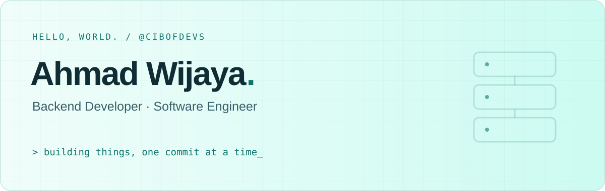

<p>
  <picture>
    <source media="(prefers-color-scheme: dark)" srcset="./assets/banner-dark.svg" />
    <source media="(prefers-color-scheme: light)" srcset="./assets/banner-light.svg" />
    
  </picture>
  <br /><br />
</p>

Hi, I'm Ahmad 👋🏻  
Software Engineer with **6+ years of experience**.  
Currently working as a Backend Developer at [PAYOK](https://payok.com).

[Website ↗](https://cibofdevs.github.io) · [LinkedIn ↗](https://www.linkedin.com/in/cibofdevs) · [Buy me a coffee ↗](https://ko-fi.com/cibofdevs)

---

### `01 / whoami`

```json
{
  "name": "Ahmad Wijaya",
  "handle": "@cibofdevs",
  "role": "Backend Developer",
  "company": "PAYOK"
}
```

### `02 / explore my work`

Projects, experiments, and things I've built.  
Explore my pinned repositories below ↓

---

Let's connect and exchange ideas.
